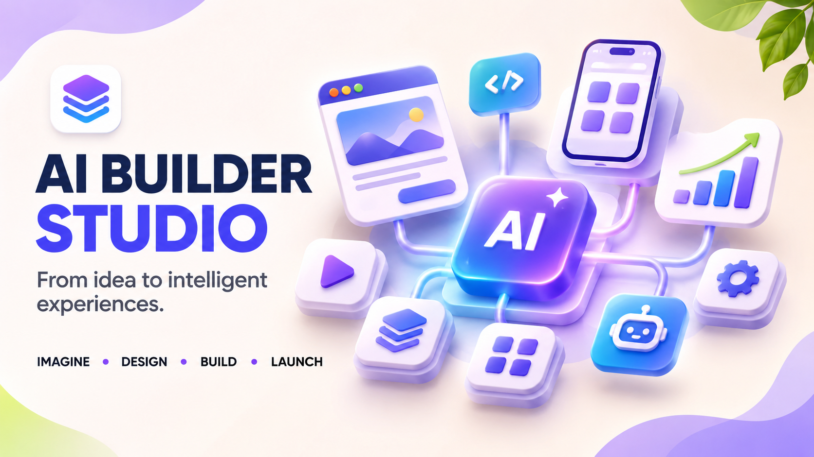
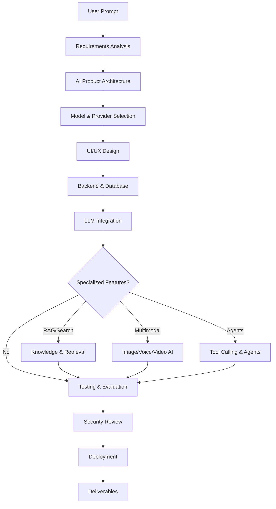

<div align="center">

[](https://github.com/TheMamunZx/ai-builder-studio)
[](https://claude.ai/code)
[](https://opencode.dev)
[](.)
[](.)

**Professional AI application development framework for coding agents**

[Quick Start](#quick-start) • [Installation](#installation) • [Documentation](#documentation-and-resources) • [Modules](#internal-specialist-modules)

</div>

---

## About AI Builder Studio

**AI Builder Studio** is a comprehensive master skill for building production-grade AI applications. It provides a unified workflow for LLM integration, RAG systems, multimodal AI, agent development, and human-centered product design—coordinated through a single discoverable skill.

Built for **Claude Code** and **OpenCode**, AI Builder Studio handles the full development lifecycle from requirements analysis through deployment, with specialist modules for model integration, inference optimization, evaluation, and design quality.

### Key Features

- **Single Master Skill Architecture** — One discoverable entry point coordinates 13 internal specialist modules
- **Full-Stack AI Development** — LLM apps, chatbots, RAG systems, multimodal AI, and agent integration
- **Provider-Aware Design** — Explicit separation between model capabilities and external service configuration
- **Human-Centered Product Design** — Professional UX, visual hierarchy, accessibility, and design quality review
- **Evaluation & Testing** — AI-specific testing strategies, quality gates, and evaluation frameworks
- **Production-Ready** — Security, privacy, rate limits, error handling, and deployment guidance

---

## Project Overview

<table>
<tr>
<td><strong>Repository</strong></td>
<td><code>ai-builder-studio</code></td>
</tr>
<tr>
<td><strong>Master Skill</strong></td>
<td><code>ai-builder-studio</code></td>
</tr>
<tr>
<td><strong>Discoverable Skills</strong></td>
<td>1</td>
</tr>
<tr>
<td><strong>Internal Modules</strong></td>
<td>13</td>
</tr>
<tr>
<td><strong>Compatible Agents</strong></td>
<td>Claude Code, OpenCode</td>
</tr>
<tr>
<td><strong>Architecture</strong></td>
<td>Single master skill with internal specialist references</td>
</tr>
</table>

---

## What Can You Build?

AI Builder Studio supports a wide range of AI application development scenarios:

### AI Applications & Chatbots
- **Conversational AI** — Chat interfaces, conversation history, context management
- **AI Assistants** — Personal assistants, productivity tools, knowledge helpers
- **Customer Support Bots** — Support automation, FAQ systems, escalation flows

### Knowledge & Retrieval Systems
- **RAG Applications** — Document retrieval, semantic search, knowledge bases
- **AI Search** — Intelligent search interfaces, query understanding, result ranking
- **Research Tools** — Information extraction, summarization, citation management

### Multimodal AI
- **Image AI** — Image generation, analysis, editing, classification
- **Voice AI** — Speech-to-text, text-to-speech, voice interfaces
- **Video AI** — Video analysis, generation, editing workflows

### AI Agents & Automation
- **Tool-Calling Agents** — Function calling, API integration, workflow automation
- **Multi-Agent Systems** — Agent orchestration, task delegation, coordination
- **AI Workflows** — Complex multi-step AI processes

### Product Development
- **Human-Centered Design** — Professional UI/UX, visual systems, accessibility
- **Design Quality Review** — Design critique, consistency checks, usability evaluation
- **Product Experience** — End-to-end product flows, user journeys, interaction design

---

## Master Skill Architecture

AI Builder Studio uses a **single master skill** architecture. You invoke **one skill** that automatically coordinates the appropriate internal specialist modules based on your project requirements.

### How It Works

```
┌─────────────────────────────────────────┐
│   User Invokes Master Skill             │
│   /ai-builder-studio                    │
└──────────────┬──────────────────────────┘
               │
               ▼
┌─────────────────────────────────────────┐
│   AI Builder Studio                     │
│   (Master Skill Coordinator)            │
└──────────────┬──────────────────────────┘
               │
               │ Loads relevant modules automatically
               │
               ▼
┌─────────────────────────────────────────┐
│   Internal Specialist Modules           │
│                                         │
│   • ai-application-engineer             │
│   • ai-model-integration                │
│   • rag-engineer                        │
│   • multimodal-ai-engineer              │
│   • ai-inference-optimizer              │
│   • ai-voice-engineer                   │
│   • ai-image-engineer                   │
│   • ai-video-engineer                   │
│   • ai-search-engineer                  │
│   • ai-evaluation-engineer              │
│   • human-centered-product-design       │
│   • design-quality-critic               │
│   • product-experience-engineer         │
│                                         │
└─────────────────────────────────────────┘
```

### Why Single Master Skill?

- **Simpler Discovery** — Users don't need to learn or select individual modules
- **Automatic Coordination** — Master skill loads only relevant modules for each task
- **Consistent Workflow** — Unified approach across all AI development scenarios
- **Better Context** — Master skill maintains coordination across specialist areas

**You do not select individual specialist modules.** The master skill handles module loading automatically.

---

## Internal Specialist Modules

The master skill coordinates these 13 internal specialist modules:

| Module | Focus Area |
|--------|------------|
| **ai-application-engineer** | AI app architecture, conversation UX, streaming, history, files, memory, safety, quotas |
| **ai-model-integration** | Provider integration, model selection, API routing, fallback strategies, SDK configuration |
| **rag-engineer** | Document retrieval, vector databases, semantic search, chunking, embedding strategies |
| **multimodal-ai-engineer** | Cross-modal workflows, image+text, voice+text, video+text, multi-modal prompting |
| **ai-inference-optimizer** | Latency optimization, caching, batching, model quantization, cost reduction strategies |
| **ai-voice-engineer** | Speech-to-text, text-to-speech, voice interfaces, audio processing pipelines |
| **ai-image-engineer** | Image generation, analysis, editing, classification, vision model integration |
| **ai-video-engineer** | Video analysis, generation, editing, multimodal video workflows |
| **ai-search-engineer** | Intelligent search, query understanding, result ranking, search UX |
| **ai-evaluation-engineer** | AI testing, evaluation frameworks, quality metrics, safety checks, hallucination detection |
| **human-centered-product-design** | User research, information architecture, design systems, accessibility, responsive design |
| **design-quality-critic** | Design review, visual consistency, usability evaluation, design principle enforcement |
| **product-experience-engineer** | End-to-end product flows, user journeys, interaction patterns, experience quality |

All modules are **internal references**, not separately discoverable skills. The master skill loads them as needed.

---

## AI Application Development Workflow



### Development Phases

1. **Requirements Analysis** — Define goals, users, scope, constraints, acceptance criteria
2. **Architecture Design** — Provider abstraction, data flow, component structure, deployment model
3. **Model Selection** — Choose providers, models, fallback strategies, cost/latency tradeoffs
4. **UI/UX Design** — Information architecture, visual system, responsive design, accessibility
5. **Backend Development** — Database, API routes, authentication, rate limiting, caching
6. **LLM Integration** — Model API integration, streaming, context management, error handling
7. **Specialized Features** — RAG, multimodal, agents, tool calling (when needed)
8. **Testing & Evaluation** — AI-specific tests, evaluation cases, quality metrics
9. **Security Review** — Data protection, input validation, credential management, privacy
10. **Deployment** — Environment configuration, monitoring, rollout strategy

---

## LLM and Model Integration

AI Builder Studio supports integration with multiple LLM providers through the **ai-model-integration** module.

### Supported Integration Patterns

- **Provider Abstraction** — Unified interface across multiple providers
- **Model Selection** — Dynamic model selection based on task requirements
- **Streaming** — Real-time response streaming with proper cancellation
- **Context Management** — Token counting, context window handling, conversation history
- **Error Handling** — Graceful degradation, retry strategies, timeout management
- **Rate Limiting** — Request throttling, quota management, backoff strategies

### Provider Configuration

**AI Builder Studio provides instructions and patterns for model integration.** Actual model access requires:

- Provider API keys (OpenAI, Anthropic, Google, etc.)
- SDK installation and configuration
- Environment variable setup
- Rate limit and quota management

**No models or API access are included.** You must configure your own provider credentials.

### Example Providers

Common providers that can be integrated:
- **Anthropic Claude** — Claude 3.5 Sonnet, Claude 3 Opus, Claude 3 Haiku
- **OpenAI** — GPT-4, GPT-3.5-turbo, GPT-4 Turbo
- **Google** — Gemini Pro, Gemini Ultra
- **Open Source** — Llama, Mistral, Mixtral (via Ollama, Together, Replicate)

Refer to provider documentation for current model IDs, capabilities, and pricing.

---

## AI Chatbot and Assistant Development

Build conversational AI applications with the **ai-application-engineer** module.

### Capabilities

- **Conversation Management** — Multi-turn conversations, history, context windows
- **Streaming Responses** — Real-time token streaming, cancellation, progress indicators
- **File Handling** — Document upload, analysis, multi-file conversations
- **User Controls** — Clear history, regenerate, edit messages, export conversations
- **Safety & Moderation** — Content filtering, abuse detection, rate limiting
- **Personalization** — User profiles, preferences, conversation memory

### Chat Interface Patterns

- System prompts and instruction tuning
- Few-shot examples and in-context learning
- Temperature and sampling parameter control
- Response formatting and structured outputs
- Error states and fallback messages
- Loading and streaming UI states

---

## RAG and Knowledge Systems

Build retrieval-augmented generation systems with the **rag-engineer** module.

### RAG Architecture Components

- **Document Processing** — Text extraction, chunking strategies, metadata extraction
- **Embeddings** — Vector generation, embedding model selection, dimension optimization
- **Vector Databases** — Storage solutions (Pinecone, Weaviate, Chroma, Qdrant, pgvector)
- **Retrieval** — Semantic search, hybrid search, re-ranking, relevance scoring
- **Context Assembly** — Retrieved document integration, prompt construction, citation
- **Evaluation** — Retrieval quality, answer accuracy, hallucination detection

### RAG Development Workflow

1. **Data Preparation** — Collect, clean, and structure knowledge base
2. **Chunking Strategy** — Define chunk size, overlap, semantic boundaries
3. **Embedding Generation** — Choose embedding model, generate vectors
4. **Vector Store Setup** — Configure database, indexing, metadata filtering
5. **Retrieval Pipeline** — Search query processing, retrieval logic, result ranking
6. **Generation Pipeline** — Context assembly, prompt engineering, response generation
7. **Evaluation** — Test retrieval quality, answer correctness, citation accuracy

**External services required:** Vector database, embedding API, document processing tools.

---

## Multimodal AI Development

Build applications that work with images, voice, and video using multimodal specialist modules.

### Image AI (`ai-image-engineer`)

- **Image Generation** — Text-to-image, image editing, style transfer
- **Image Analysis** — Object detection, classification, OCR, visual Q&A
- **Image Processing** — Resizing, format conversion, optimization
- **Vision Models** — GPT-4 Vision, Claude 3 Vision, Gemini Vision

**Requires:** Image generation API (DALL-E, Midjourney, Stable Diffusion) or vision model access.

### Voice AI (`ai-voice-engineer`)

- **Speech-to-Text** — Audio transcription, real-time recognition, speaker identification
- **Text-to-Speech** — Voice synthesis, voice selection, prosody control
- **Voice Interfaces** — Voice commands, conversational voice UX
- **Audio Processing** — Format conversion, noise reduction, audio segmentation

**Requires:** STT/TTS API (OpenAI Whisper, Google Cloud Speech, ElevenLabs, etc.)

### Video AI (`ai-video-engineer`)

- **Video Analysis** — Scene detection, object tracking, activity recognition
- **Video Generation** — Text-to-video, video editing, scene composition
- **Video Processing** — Transcoding, thumbnail generation, clip extraction
- **Multimodal Video** — Video + audio + text workflows

**Requires:** Video processing libraries, video analysis APIs, GPU for local processing.

---

## AI Agent and Tool Calling Integration

Build AI agents with tool-calling capabilities using the **ai-application-engineer** module's agent integration patterns.

### Agent Capabilities

- **Function Calling** — Define tools, schemas, automatic function execution
- **Multi-Tool Orchestration** — Coordinate multiple tools in single workflow
- **External API Integration** — Connect LLMs to external services
- **Error Recovery** — Handle tool failures, retries, fallback strategies
- **Agent Memory** — Maintain state across tool executions

### Tool Calling Patterns

1. **Tool Definition** — Define available functions with clear schemas
2. **Prompt Engineering** — Instruct model on tool usage and selection
3. **Execution Layer** — Safe tool execution, parameter validation
4. **Response Integration** — Feed tool results back into conversation
5. **Error Handling** — Manage API failures, invalid parameters, timeouts

**Supported by:** OpenAI Function Calling, Claude Tool Use, Gemini Function Calling.

---

## Human-Centered Product Design

AI Builder Studio includes three modules focused on creating professional, usable, and visually consistent AI products.

### Design Modules

| Module | Purpose |
|--------|---------|
| **human-centered-product-design** | User research, information architecture, design systems, visual hierarchy, responsive design, accessibility |
| **design-quality-critic** | Design review, consistency checks, usability evaluation, design principle enforcement |
| **product-experience-engineer** | End-to-end user journeys, interaction patterns, experience quality, product polish |

### Design Quality Focus Areas

- **Unique Product Identity** — Distinctive design, not generic AI templates
- **Professional Typography** — Type scale, font pairing, readability
- **Visual Hierarchy** — Information architecture, content organization, scanning patterns
- **Consistent Spacing** — Design tokens, spacing system, visual rhythm
- **Thoughtful Color Systems** — Color palettes, contrast, dark mode, accessibility
- **Natural Interactions** — Intuitive controls, clear affordances, helpful feedback
- **Responsive Interfaces** — Mobile-first, adaptive layouts, cross-device consistency
- **Accessibility** — WCAG compliance, keyboard navigation, screen reader support
- **Meaningful States** — Loading indicators, empty states, error messages, success feedback
- **Usability & UX** — User testing, friction reduction, task completion optimization

### Design Workflow

1. **User Research** — Identify primary users, jobs-to-be-done, context, constraints
2. **Information Architecture** — Define content hierarchy, navigation, task flows
3. **Design System** — Establish tokens for typography, spacing, color, components
4. **Component Design** — Build reusable components with semantic states
5. **Responsive Design** — Validate mobile, tablet, desktop experiences
6. **Accessibility** — Test keyboard navigation, screen readers, contrast, motion
7. **Design Review** — Critique consistency, usability, visual quality

**Note:** Automated design generation has limits. Design quality requires human review and iteration.

---

## Quick Start

### Prerequisites

- **Claude Code** or **OpenCode** installed
- Project repository initialized
- Development environment configured

### Basic Usage

**Claude Code:**
```text
/ai-builder-studio
```

**OpenCode:**
```text
@ai-builder-studio
```

### Example Prompts

**Build an AI chatbot:**
```text
/ai-builder-studio Create a customer support chatbot with conversation history and file upload support
```

**Build a RAG system:**
```text
/ai-builder-studio Build a document Q&A system with semantic search over uploaded PDFs
```

**Build a multimodal app:**
```text
/ai-builder-studio Create an image analysis app that generates descriptions and answers questions about images
```

**Design review:**
```text
/ai-builder-studio Review the UX design of my AI chat interface and suggest improvements
```

The master skill will automatically load relevant internal modules and coordinate the complete workflow.

---

## Installation

### Project-Local Installation

**Recommended for most projects.** Install AI Builder Studio in a specific project:

1. Navigate to your project directory
2. Copy the master skill folder:
   ```bash
   cp -r /path/to/ai-builder-studio/.claude/skills/ai-builder-studio ./claude/skills/
   ```
3. Verify the skill structure:
   ```bash
   ls .claude/skills/ai-builder-studio/
   # Should contain: SKILL.md, references/, templates/, scripts/, assets/
   ```
4. Invoke the skill in your coding agent

### Claude Code Installation

1. Clone this repository:
   ```bash
   git clone https://github.com/TheMamunZx/ai-builder-studio.git
   ```

2. Copy the master skill folder to your project:
   ```bash
   cp -r ai-builder-studio/.claude/skills/ai-builder-studio /path/to/your-project/.claude/skills/
   ```

3. Use the skill in Claude Code:
   ```text
   /ai-builder-studio
   ```

### OpenCode Installation

1. Copy the master skill folder to your OpenCode skills directory:
   ```bash
   cp -r ai-builder-studio/.claude/skills/ai-builder-studio ~/.opencode/skills/
   ```

2. Restart OpenCode or reload skills

3. Use the skill:
   ```text
   @ai-builder-studio
   ```

### Verification

Check that the skill is discoverable:

**Claude Code:**
```text
/help
```

**OpenCode:**
```text
@help
```

The `ai-builder-studio` skill should appear in the available skills list.

---

## Supported Models and Providers

AI Builder Studio provides integration patterns and instructions. **You must configure your own provider access.**

### Provider Configuration Requirements

Each provider requires:
- API key or authentication token
- SDK installation (provider-specific)
- Environment variable configuration
- Rate limit and quota awareness

### Common Provider Setup

**Anthropic Claude:**
```bash
export ANTHROPIC_API_KEY=your_api_key_here
npm install @anthropic-ai/sdk  # or pip install anthropic
```

**OpenAI:**
```bash
export OPENAI_API_KEY=your_api_key_here
npm install openai  # or pip install openai
```

**Google Generative AI:**
```bash
export GOOGLE_API_KEY=your_api_key_here
npm install @google/generative-ai  # or pip install google-generativeai
```

### Model Selection Considerations

- **Task complexity** — Advanced reasoning vs. simple classification
- **Latency requirements** — Real-time vs. batch processing
- **Cost constraints** — Input/output token pricing
- **Context window** — Document length, conversation history
- **Modality support** — Text-only vs. vision vs. multimodal
- **Rate limits** — Requests per minute, tokens per day

Refer to provider documentation for current models, capabilities, and pricing.

---

## API and Provider Configuration

### Environment Variables

**Required for LLM integration:**
```bash
# Provider API keys
ANTHROPIC_API_KEY=sk-ant-xxx
OPENAI_API_KEY=sk-xxx
GOOGLE_API_KEY=xxx

# Optional: Model configuration
DEFAULT_MODEL=claude-3-5-sonnet-20241022
MAX_TOKENS=4096
TEMPERATURE=0.7

# Optional: Rate limiting
MAX_REQUESTS_PER_MINUTE=10
REQUEST_TIMEOUT_MS=30000
```

**Required for RAG systems:**
```bash
# Vector database
PINECONE_API_KEY=xxx
PINECONE_ENVIRONMENT=us-west1-gcp
PINECONE_INDEX_NAME=knowledge-base

# OR for local vector store
CHROMA_PERSIST_DIRECTORY=./data/chroma
```

**Required for multimodal AI:**
```bash
# Image generation
OPENAI_API_KEY=sk-xxx  # For DALL-E
STABILITY_API_KEY=xxx  # For Stable Diffusion

# Speech
ELEVENLABS_API_KEY=xxx  # For TTS
DEEPGRAM_API_KEY=xxx    # For STT
```

### Security Best Practices

- **Never commit API keys** to version control
- Use **environment variables** or secret management services
- Implement **rate limiting** to prevent abuse
- Add **request validation** and input sanitization
- Monitor **API usage** and costs
- Rotate **credentials** regularly
- Use **least-privilege** access for API keys

---

## Database and Memory Systems

### Database Options

AI applications may require:

- **Relational Database** — User accounts, conversation history, app state (PostgreSQL, MySQL)
- **Vector Database** — RAG, semantic search, embeddings (Pinecone, Weaviate, Chroma, Qdrant)
- **Cache Layer** — Response caching, session management (Redis, Memcached)
- **Object Storage** — File uploads, media assets (S3, GCS, Azure Blob)

### Conversation Memory

Patterns for conversation history:

1. **In-Memory** — Session-based, ephemeral (development only)
2. **Database-Backed** — Persistent, queryable (production recommended)
3. **Redis Cache** — Fast access, TTL-based expiration
4. **Token-Aware** — Track token usage, implement context window management

### Data Persistence

Consider:
- User authentication and authorization
- Conversation history storage
- File upload management
- Usage tracking and analytics
- Audit logs and compliance

---

## Testing and AI Evaluation

The **ai-evaluation-engineer** module provides AI-specific testing strategies.

### Testing Layers

1. **Unit Tests** — Individual functions, utilities, data processing
2. **Integration Tests** — Provider APIs, database connections, external services
3. **AI Evaluation** — Model output quality, hallucination detection, safety
4. **End-to-End Tests** — Complete user workflows, UI interactions
5. **Performance Tests** — Latency, throughput, cost per request

### AI-Specific Evaluation

- **Output Quality** — Accuracy, relevance, completeness
- **Consistency** — Similar inputs produce similar outputs
- **Safety** — Content filtering, bias detection, harmful output prevention
- **Hallucination Detection** — Verify factual claims, check citations
- **Edge Cases** — Unusual inputs, adversarial examples, boundary conditions
- **Cost Tracking** — Token usage, API costs, latency metrics

### Evaluation Workflow

1. **Define Evaluation Cases** — Representative examples, edge cases, failure scenarios
2. **Create Ground Truth** — Expected outputs, acceptable variations
3. **Run Evaluations** — Automated test execution, manual review
4. **Score Outputs** — Quantitative metrics, qualitative assessment
5. **Iterate** — Refine prompts, adjust parameters, update examples

**Tools:** LangSmith, PromptLayer, Weights & Biases, custom evaluation scripts.

---

## Security and Privacy

### Security Considerations

- **Input Validation** — Sanitize user inputs, prevent injection attacks
- **Output Filtering** — Content moderation, PII detection, sensitive data removal
- **Authentication** — User identity verification, session management
- **Authorization** — Role-based access control, resource permissions
- **Rate Limiting** — Prevent abuse, DDoS protection, quota enforcement
- **Audit Logging** — Track user actions, API calls, security events

### Privacy Best Practices

- **Data Minimization** — Collect only necessary data
- **User Consent** — Clear data usage policies, opt-in mechanisms
- **Data Retention** — Define retention periods, implement deletion
- **Encryption** — Data at rest and in transit
- **Compliance** — GDPR, CCPA, HIPAA (domain-specific)
- **Anonymization** — Remove or hash PII where possible

### Credential Management

**Never expose secrets:**
- Use environment variables
- Implement secret management (AWS Secrets Manager, HashiCorp Vault)
- Rotate credentials regularly
- Audit access logs
- Implement least-privilege access

---

## Deployment Guide

### Deployment Checklist

- [ ] Environment variables configured
- [ ] API keys and credentials secured
- [ ] Database migrations completed
- [ ] Rate limiting implemented
- [ ] Error handling and logging configured
- [ ] Monitoring and alerting set up
- [ ] Performance testing completed
- [ ] Security review conducted
- [ ] Documentation updated
- [ ] Rollback plan prepared

### Deployment Platforms

**Serverless:**
- **Vercel** — Next.js, streaming support, edge functions
- **Netlify** — Jamstack, serverless functions
- **AWS Lambda** — Custom runtimes, API Gateway integration

**Container-Based:**
- **Docker** — Containerize application, dependencies
- **Kubernetes** — Orchestration, scaling, load balancing
- **Cloud Run** — Managed containers, auto-scaling

**Traditional:**
- **VPS** — Full control, custom configuration (DigitalOcean, Linode)
- **Platform as a Service** — Managed infrastructure (Heroku, Railway, Render)

### Production Considerations

- **Scaling** — Horizontal scaling, load balancing, caching
- **Monitoring** — Application metrics, error tracking, uptime monitoring
- **Logging** — Structured logs, log aggregation, search
- **Backup** — Database backups, disaster recovery
- **CDN** — Static asset delivery, edge caching
- **SSL/TLS** — HTTPS enforcement, certificate management

---

## Output Structure and Deliverables

Typical deliverables from an AI Builder Studio workflow:

### Architecture & Design
- System architecture diagram
- Component structure
- Data flow diagrams
- Technology stack documentation
- Design system and tokens

### Implementation
- Complete application code
- Provider integration layer
- Database schema and migrations
- API routes and endpoints
- Frontend components

### Configuration
- Environment variable template
- Provider configuration guide
- Deployment instructions
- Database setup guide
- Secrets management setup

### Testing & Evaluation
- Unit and integration tests
- AI evaluation test cases
- Performance benchmarks
- Security audit results
- Quality metrics report

### Documentation
- README with setup instructions
- API documentation
- User guides
- Deployment guide
- Troubleshooting guide

---

## Troubleshooting and FAQ

### Common Issues

**Skill not discoverable:**
- Verify `.claude/skills/ai-builder-studio/` folder exists
- Check `SKILL.md` frontmatter has correct `name: ai-builder-studio`
- Restart coding agent or reload skills
- Check agent version supports skill discovery

**Provider API errors:**
- Verify API key is correct and active
- Check rate limits and quotas
- Confirm SDK is installed and up-to-date
- Review provider status page for outages
- Check error messages for specific issues

**RAG retrieval quality poor:**
- Adjust chunking strategy (chunk size, overlap)
- Try different embedding models
- Tune retrieval parameters (top_k, similarity threshold)
- Implement hybrid search (keyword + semantic)
- Add re-ranking step

**High latency:**
- Implement response caching
- Use smaller/faster models for simple tasks
- Enable streaming for better perceived performance
- Optimize database queries
- Add CDN for static assets

**High costs:**
- Use smaller models where appropriate
- Implement prompt caching
- Reduce context window size
- Batch API requests
- Monitor token usage and optimize prompts

### FAQ

**Q: Does AI Builder Studio include model access?**  
A: No. You must configure your own provider API keys and credentials.

**Q: Can I use this with open-source models?**  
A: Yes. The integration patterns work with any OpenAI-compatible API (Ollama, Together, Replicate, etc.).

**Q: Do I need a vector database for all projects?**  
A: No. Only RAG and semantic search projects require a vector database.

**Q: Can I customize the internal specialist modules?**  
A: Yes. Fork the repository and modify modules to fit your needs. Preserve the master skill structure.

**Q: How do I update AI Builder Studio?**  
A: Pull the latest version and replace `.claude/skills/ai-builder-studio/` in your project.

**Q: Can I use this for production applications?**  
A: Yes, with proper testing, security review, and monitoring. AI Builder Studio provides guidance, but production readiness requires validation.

---

## Documentation and Resources

### Project Documentation

- [SKILL.md](./.claude/skills/ai-builder-studio/SKILL.md) — Master skill definition
- [CONSOLIDATION_MAP.md](./CONSOLIDATION_MAP.md) — Specialist module mapping
- [AGENTS.md](./AGENTS.md) — Agent operating guide
- [CHANGELOG.md](./CHANGELOG.md) — Version history

### Internal References

All specialist modules are in [`.claude/skills/ai-builder-studio/references/`](./.claude/skills/ai-builder-studio/references/):

- `ai-application-engineer.md`
- `ai-model-integration.md`
- `rag-engineer.md`
- `multimodal-ai-engineer.md`
- `ai-inference-optimizer.md`
- `ai-voice-engineer.md`
- `ai-image-engineer.md`
- `ai-video-engineer.md`
- `ai-search-engineer.md`
- `ai-evaluation-engineer.md`
- `human-centered-product-design.md`
- `design-quality-critic.md`
- `product-experience-engineer.md`

### External Resources

**Coding Agents:**
- [Claude Code](https://claude.ai/code) — Anthropic's official coding agent
- [OpenCode](https://opencode.dev) — Open-source coding agent platform

**LLM Providers:**
- [Anthropic Claude](https://www.anthropic.com/claude) — Claude 3.5 Sonnet, Opus, Haiku
- [OpenAI](https://platform.openai.com/) — GPT-4, GPT-3.5-turbo
- [Google AI](https://ai.google.dev/) — Gemini Pro, Gemini Ultra

**Vector Databases:**
- [Pinecone](https://www.pinecone.io/) — Managed vector database
- [Weaviate](https://weaviate.io/) — Open-source vector database
- [Chroma](https://www.trychroma.com/) — Lightweight vector database
- [Qdrant](https://qdrant.tech/) — Vector similarity search engine

**Development Tools:**
- [LangChain](https://www.langchain.com/) — LLM application framework
- [LlamaIndex](https://www.llamaindex.ai/) — Data framework for LLM apps
- [LangSmith](https://www.langchain.com/langsmith) — LLM debugging and monitoring

---

## Validation

Run the validation script to verify package structure:

```bash
python scripts/validate_pack.py
```

The validator checks:
- Master skill existence and frontmatter
- All expected reference files
- Directory structure
- Accidental credential patterns

**Note:** Validation does not verify provider API availability or guarantee production behavior.

---

## Contributing

Contributions are welcome. When contributing:

1. Preserve the single master skill architecture
2. Add new capabilities as internal references, not separate skills
3. Update `skill-manifest.json` and validation checks
4. Follow existing module structure and documentation patterns
5. Test changes with Claude Code or OpenCode
6. Update README and CHANGELOG

---

## License

This repository contains agent instructions, reference playbooks, templates, and helper scripts.

It is **not** a model, API subscription, cloud runtime, media generation engine, or deployment service.

Actual capabilities depend on tools, credentials, permissions, provider terms, quotas, dependencies, and hardware configured in your environment.

---

## Support

- **GitHub Issues** — [Report bugs and request features](https://github.com/TheMamunZx/ai-builder-studio/issues)
- **Documentation** — See links above for detailed guides
- **Community** — Share experiences and best practices

---

<div align="center">

**AI Builder Studio** — Professional AI application development for coding agents

Built by [TheMamunZx](https://github.com/TheMamunZx)

</div>
